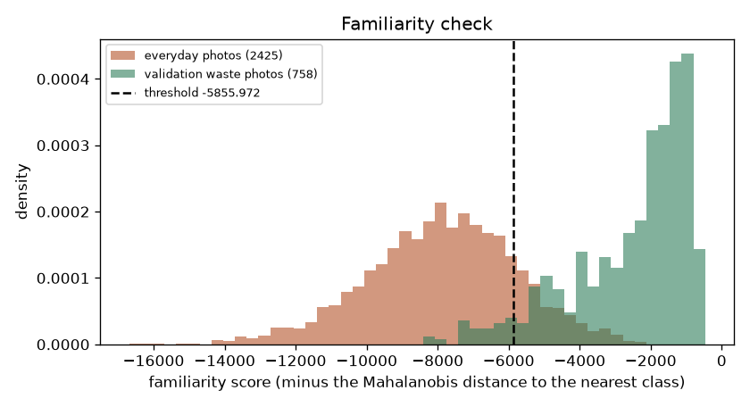
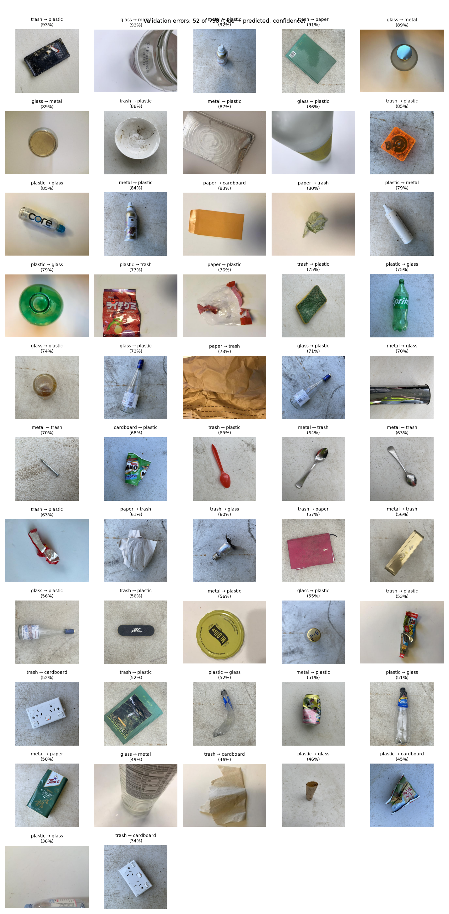

# Waste Sorting Classifier

[](https://github.com/vladzpop11/waste-sorting-classifier/actions/workflows/ci.yml)

Classify a photo of a waste item into six recycling categories: cardboard, glass, metal, paper, plastic or trash. The model is a pre-trained network fine-tuned on a free Kaggle GPU, exported to ONNX, and served two ways: from Docker with no PyTorch, and in the browser. Version 4 learns from two kinds of photo: clean studio shots (TrashNet) and real, worn waste photographed at a landfill (RealWaste).

## Result in brief

Test photos with no near-duplicate in training, evaluated once:

| | Version 4 | Version 3 (studio photos only), same photos | Difference, 95% CI |
| --- | --- | --- | --- |
| **Real waste** (RealWaste, 397 photos): accuracy | **88.7%** (83.7–92.9%) | 33.0% | **+55.7 points** (+47.4 to +63.2) |
| **Studio photos** (TrashNet, 366 photos): accuracy | **94.8%** (91.4–97.3%) | 94.3% | +0.5 points (−1.8 to +3.1) |
| Both, macro F1 | 0.916 (0.881–0.941) | | |
| Photos flagged "not a photo the model knows": real waste / studio | 10.6% / 6.8% | 78.8% / 7.7% | |
| Everyday photos (people, animals, buildings) flagged | 83.8% | 91.6% | |

The intervals resample whole groups of similar photos.

- **Version 4 handles real waste.** Version 3, trained on studio photos only, was barely better than chance on crushed cans, broken glass and dirty paper on a concrete floor. Its own familiarity check flagged 79% of them as unfamiliar. Version 4 gets 88.7% of them right and loses nothing on studio photos.
- **The test sets measure new objects.** Photos of the same object are kept on one side of the split, with a checked guarantee, across both sources. See [Data](#data).
- **It says when a photo is outside its setting.** A classifier must pick a class even for a photo of a person. A familiarity check flags photos unlike anything in training instead of labelling them. See [Photos the model doesn't know](#photos-the-model-doesnt-know).
- **It is still one item, photographed from above.** Hands holding things, bins full of things and busy scenes are not in either dataset and get flagged.

**Try it:** [huggingface.co/spaces/VladZpp/waste-sorting-classifier](https://huggingface.co/spaces/VladZpp/waste-sorting-classifier). The model runs in your browser, so photos never leave your device.

## Versions

1. **Version 1:** TrashNet only. Its split leaked near-duplicate photos into the test set and was replaced ([reports/history/v1](reports/history/v1)).
2. **Version 2:** a leak-proof split, three seeds per architecture and a selection rule fixed before training. Test accuracy 94.3%.
3. **Version 3:** the version 2 model plus a familiarity check, added after a phone test showed portraits and landscapes labelled "paper" at 80% ([reports/history/v3](reports/history/v3)).
4. **Version 4 (this one):** adds RealWaste, retrains, and replaces the familiarity check with one that works better for the broader model.

## How to run

Requires Python 3.12 via [uv](https://docs.astral.sh/uv/), `make` and Docker. `make help` lists every target.

```bash
make setup data       # dependencies, then both datasets (SHA-256 and class counts checked)
make fetch-model      # the served model and familiarity file from the GitHub release (SHA-256 checked)
make docker-build docker-run
curl -s --retry 10 --retry-connrefused --retry-delay 1 localhost:8000/health
curl -s -X POST localhost:8000/predict -F file=@tests/example.jpg
make docker-stop
```

- **`POST /predict`** takes a JPEG, PNG or WebP upload (field `file`, up to 5 MB, 25 megapixels, 10:1 aspect ratio). It returns:
  - the label and all six probabilities;
  - `familiar` and its `familiarity_score`. When `familiar` is false, the photo is unlike the training photos and the label is not reliable.

  Interactive docs: `GET /docs`.
- **Refused inputs** get an error with one shape, `{"detail": [{"type", "loc", "msg"}]}`: 413 too large, 415 not a multipart upload, 422 not a readable image or outside the limits, 503 busy (two predictions at a time).
- **Pipeline targets,** in order: `make data split`, `make baseline`, `make smoke-train` (one CPU epoch), training on Kaggle, `make select`, `make export`, `make errors`, `make familiarity-data familiarity`, `make evaluate` (once), `make latency`, `make web`.
- **Checks:** `make check` (Ruff and pytest), `make docker-smoke`, `make check-web` (the browser against Python; needs Node.js and Chrome). CI runs all three.

## Data

Two sources, both downloaded and checked by `make data`: archive SHA-256 and published class counts. The full account, with the evidence for every choice, is in [reports/data.md](reports/data.md).

| | TrashNet | RealWaste |
| --- | --- | --- |
| Photos | 2,521 (after removing 3 pairs of identical files filed under two classes) | 3,904 of 4,752 (food organics and vegetation are not used; one photo left out, below) |
| What they show | One item on a white background, studio-like | Real waste at a landfill's reception point, one item on a concrete floor |
| Classes | ours | cardboard, glass, metal, paper, plastic as is; miscellaneous and textile trash → trash |
| Train / validation / test | 1,795 / 360 / 366 (unchanged since version 2) | 3,109 / 398 / 397 |
| Licence | MIT | CC BY-NC-SA 4.0 (see [Licence](#licence)) |

**Keeping each object on one side of the split.** Both datasets photograph many objects more than once, so a random split would test on objects the model has already seen.

1. **Grouping:** photos are compared by cosine similarity of ImageNet ResNet18 features, within each class, and every pair at 0.86 or above is joined into one group. The threshold comes from looking at pairs in each similarity band; it holds for both sources ([TrashNet pairs](reports/figures/similarity_pairs.png), [RealWaste pairs](reports/figures/similarity_pairs_realwaste.png)).
2. **TrashNet keeps its version 2 split exactly** ([splits/trashnet-v2.csv](splits/trashnet-v2.csv)). Its test photos have never been trained on, and versions can be compared on them.
3. **RealWaste is split anew, with three rules:**
   - Groups are assigned with StratifiedGroupKFold.
   - A group that has a near-duplicate among TrashNet photos follows that photo's split. One RealWaste photo was left out because it tied a group to both TrashNet training and validation photos.
   - Look-alike chains of more than 20 photos go to training, so validation and test consist of many independent objects. Without this, one 130-photo chain of glass photos would have been RealWaste's entire glass test set.
4. **The guarantee:** `make split` refuses to save a split in which any validation or test photo, from either source, has a same-class training photo at 0.86 or above. The highest is 0.8599. The split is committed in [splits/split.csv](splits/split.csv), and every image is checked against its SHA-256 whenever it is loaded.

## Approach

1. **Preprocessing written once.** [preprocess.py](src/waste_sorting_classifier/preprocess.py) reproduces torchvision's evaluation transform without PyTorch (tested to 1e-6). It turns photos upright from EXIF, scales 16-bit images, flattens transparency onto white, and refuses oversized or very elongated images. Validation, export, the API and both demos use it.
2. **Training on a Kaggle T4 GPU** ([kaggle/train.ipynb](kaggle/train.ipynb)): the notebook clones a fixed tag of this repository (`train-v4`) and runs the unchanged training module.
   - **Recipe:** ImageNet-pretrained backbone with a new head; augmentation (random crops, flips, colour jitter) for training only; AdamW with a cosine schedule and label smoothing; early stopping on validation loss. No settings were tuned.
   - **Tracking:** every epoch is logged to MLflow, in a SQLite store inside each run's directory.
3. **Model choice by a rule fixed before training** ([configs/config.yaml](configs/config.yaml), `selection`).
   - ResNet18 and EfficientNet-B0 are each trained with three seeds.
   - Each run's score is the mean of its validation macro F1 on TrashNet and on RealWaste, so both sources count equally.
   - The higher mean score wins; within 0.01, the faster model wins.
   - The deployed checkpoint is the winner's run with the lowest validation loss. `make select` applies the rule and records the decision with the checkpoint's SHA-256.
4. **Export on the Mac.** The selected checkpoint (its SHA-256 checked) is loaded with `weights_only=True` and exported to ONNX (opset 17), with two outputs: the logits, and the features the familiarity check reads.
   - **Equivalence:** on 20 validation photos the predictions are identical, with a maximum logit difference of 1.9e-6.
   - **Cross-check:** the ONNX model reproduces the GPU run's validation scores exactly (macro F1 0.9380 on TrashNet, 0.9128 on RealWaste).
5. **One test evaluation,** of the exported ONNX file that the API serves.
   - `make evaluate` checks that the file was exported from the selected checkpoint, and refuses to run a second time.
   - In the same run it scores version 3 on the same photos, from its release files, for the comparison above.
   - It was first rehearsed on validation (`--rehearse`), so the single real run was not the first.
6. **A browser demo with the same numbers, in every browser.** The public demo is a static page ([web/](web/)) that runs the same ONNX file with ONNX Runtime Web.
   - **Decoding without the browser:** browsers decode images differently from Pillow. Safari uses its own JPEG decoder, and browsers apply colour profiles and premultiply transparency. So the page decodes images itself ([decode.js](web/decode.js)):
     - JPEG with libjpeg-turbo 3 and WebP with libwebp, compiled to WebAssembly: the libraries Pillow uses;
     - PNG with its own decoder ([png.js](web/png.js)), using a JavaScript zlib (fflate) so that every browser behaves the same;
     - transparency flattened with Pillow's arithmetic;
     - EXIF and XMP orientation read exactly where and how Pillow reads them ([image-header.js](web/image-header.js)).
   - **Preprocessing in JavaScript:** [preprocess.js](web/preprocess.js) reproduces Pillow's fixed-point bilinear resize and Python's round-half-to-even centre crop.
   - **Proof:** `make check-web` (with `BROWSER=chrome`, `webkit` or `firefox`) runs three checks:
     - the page's decoding gives pixels identical to Python's on all 758 validation photos of both sources, on 129 unusual files (every EXIF and XMP layout, 1- to 16-bit and interlaced PNG, transparency, 4:4:0, arithmetic-coded and lossless JPEG, MPO and more), and on 30 everyday photos;
     - 26 damaged or hostile files are refused, as the API refuses them, including decompression bombs and a file that once froze the page;
     - the real page, in Chrome, WebKit (Safari's engine) and Firefox, gives Python's prediction and familiarity decision for every validation photo, with probabilities within 3e-6.
   - **Fuzzing:** about 35,000 randomly mutated JPEG, PNG and WebP files were compared between the page and Python. None hung, crashed or used unbounded memory; the slowest took under a second. Every class of difference found is either fixed or listed below, and one file per class is kept in the tests ([tests/data/web-edge](tests/data/web-edge)).
   - **Documented differences:** 11 files are handled differently from Python, each checked to stay that way ([web_edge_cases.py](src/waste_sorting_classifier/web_edge_cases.py)):
     - two valid kinds the page refuses with a message, although the API accepts them: CMYK JPEGs (from print workflows) and animated WebP;
     - files that break their format's rules, such as a PNG palette image without a palette or a JPEG without its end marker. Pillow tolerates some of these and rejects others; the page sometimes decides the other way. It never just stops responding: it either shows a result or explains that it can't read the file.
     - JPEGs with corrupt image data, which Pillow decodes with a warning, are refused by the page.

## Results

Validation (758 photos: 360 TrashNet, 398 RealWaste) ([reports/model_selection.json](reports/model_selection.json), [reports/baselines.json](reports/baselines.json)):

| Model | Macro F1, TrashNet | Macro F1, RealWaste | Rule's score |
| --- | --- | --- | --- |
| Majority class | 0.052 | 0.062 | |
| Linear probe, frozen ImageNet ResNet18 (C tuned by grouped CV on training photos) | 0.761 | 0.733 | |
| ResNet18, fine-tuned, mean of 3 seeds | 0.914 | 0.881 | 0.897 (sd 0.008) |
| **EfficientNet-B0, fine-tuned, mean of 3 seeds** | **0.940** | **0.903** | **0.921** (sd 0.006) |
| EfficientNet-B0, deployed run (seed 44) | 0.938 | 0.913 | 0.925 |

- **The rule chose EfficientNet-B0** by 0.024, more than the 0.01 margin and about three seed standard deviations.
- **The deployed run is the best of three on validation,** so its validation scores are slightly optimistic. The test results are the fair estimate.

Test, per source (evaluated once) ([reports/test_metrics.json](reports/test_metrics.json), [confusion matrix](reports/figures/confusion_test.png)):

| Class | RealWaste F1 (95% CI per photo) | Photos | TrashNet F1 (95% CI per photo) | Photos |
| --- | --- | --- | --- | --- |
| cardboard | 0.893 (0.828–0.945) | 60 | 0.983 (0.956–1.000) | 57 |
| glass | 0.914 (0.833–0.971) | 35 | 0.957 (0.918–0.986) | 71 |
| metal | 0.807 (0.713–0.882) | 60 | 0.923 (0.866–0.967) | 58 |
| paper | 0.883 (0.795–0.952) | 38 | 0.951 (0.912–0.981) | 84 |
| plastic | 0.876 (0.825–0.919) | 91 | 0.969 (0.938–0.994) | 77 |
| trash | 0.924 (0.885–0.958) | 113 | 0.800 (0.632–0.919) | 19 |
| **Macro F1** | **0.883** | 397 | **0.930** | 366 |

- **Weakest: real-waste metal.** Its recall is 73%: crushed cans and foil are called plastic or trash.
- **Studio trash got worse than in version 3:** F1 0.800 against 0.889. Trash now has 685 training photos instead of 98, mostly real waste, and more studio paper is called trash. With 19 test photos the interval is wide.
- **Studio macro F1 is slightly lower than version 3's,** 0.930 against 0.936, although accuracy is slightly higher.

**Two kinds of interval.** Resampling single photos treats each as independent evidence, which is too optimistic when photos come in families. Resampling whole groups is too cautious where groups chain look-alikes together: for example, the 77 studio plastic test photos form one group ([reports/data.md](reports/data.md)). The tables give the per-photo intervals, and the JSON report gives both.

**Accuracy depends on how familiar a photo looks.** Each test photo's similarity to its nearest same-class training photo (ImageNet features; always below 0.86 by construction):

| Nearest training photo | RealWaste photos | Accuracy | TrashNet photos | Accuracy |
| --- | --- | --- | --- | --- |
| below 0.75 | 4 | 25% | 25 | 68.0% |
| 0.75–0.80 | 58 | 79.3% | 69 | 91.3% |
| 0.80–0.85 | 275 | 90.5% | 225 | 97.8% |
| 0.85–0.86 | 60 | 93.3% | 47 | 100% |

Photos unlike any training photo of their class are much harder. That is the better guide to performance on new kinds of objects.

**Calibration** ([reliability diagram](reports/figures/reliability_test.png)):
- The model is underconfident, as label smoothing tends to make it (expected calibration error 0.060).
- Answers at 90% confidence or more were right 99.1% of the time on test (446 photos).
- The demo marks answers below 90% as less certain. That threshold was chosen on validation by a fixed rule: the lowest threshold above which validation accuracy reaches 99%.

## Photos the model doesn't know

The classifier has to answer with one of its six classes, so a photo of a person, a dog or a landscape still gets a label, sometimes a confident one. A phone test with version 2 found portraits and landscapes called paper at 80%. Since version 3, a familiarity check flags such photos. Instead of a label, the demo says the photo is not one the model knows, with the guess behind a link. The API returns `familiar` and `familiarity_score`.

**Version 4's check** ([familiarity.py](src/waste_sorting_classifier/familiarity.py), [familiarity_build.py](src/waste_sorting_classifier/familiarity_build.py)):
- **The score:** the photo's features (the 1,280 numbers the final layer reads) are compared with each class's average training features. The distance is measured in units of how much training photos vary (Mahalanobis distance, shared covariance), and the nearest class counts.
- **Threshold, by a rule fixed in [config.yaml](configs/config.yaml):** 95% of validation photos must pass.
- **False alarms on new waste photos: 4.9%** (TrashNet 4.2%, RealWaste 5.6%). The threshold is set on one half of the validation groups and the flags are counted on the other half, both ways.
- **Everyday photos flagged: 83.8%** of 2,425 [Imagenette](https://github.com/fastai/imagenette) validation photos (people with fish, dogs, churches, parachutes, golf balls, trucks and more). By class it ranges from 64% (dogs) to 97% (churches).
- **On test,** it flagged 10.6% of real-waste photos and 6.8% of studio photos. The model was right on 62–68% of the flagged ones, against 92–97% of the rest, so the photos it flags are hard ones too.

**Why this method.** Version 3 used similarity to the nearest training photo. With version 4's broader training data, that method catches fewer everyday photos. Three methods were compared on 1,500 other Imagenette photos, which are not part of the 2,425 above. Validation photos were kept at 95% for each:

| Method | Everyday photos caught | Everyday photos passed and labelled with ≥70% confidence |
| --- | --- | --- |
| Nearest training photo (version 3) | 73.0% | 17.0% |
| Energy score of the logits | 82.5% | 15.8% |
| **Mahalanobis distance (chosen)** | **83.5%** | **8.7%** |

The second column matters most: a confident wrong label on a non-waste photo is the failure the check exists to prevent.

**Version 4 is easier to fool than version 3.** Version 3 flagged 91.6% of everyday photos with its narrower training data; version 4 flags 83.8%, and 10.3% pass with 70% or more confidence. That is the price of a model that accepts real waste on ordinary floors.



[reports/familiarity.json](reports/familiarity.json) has the details. The browser computes the same score, and `make check-web` checks it against Python: within 3e-6 relative, with the same flag for every validation photo and for 30 held-out everyday photos.

## What it gets wrong



The 52 validation errors ([reports/val_errors.json](reports/val_errors.json)) and 64 test errors (45 RealWaste, 19 TrashNet) mostly fall into three groups:

- **Transparent and shiny items** confused among glass, plastic and metal, as in earlier versions: clear and green bottles, broken glass, lids.
- **Crushed metal called plastic or trash:** on test, 15 of RealWaste's 45 errors. Crumpled cans and foil look like crumpled plastic or mixed trash.
- **Trash against everything else:** trash called plastic (9 validation errors), and studio paper called trash (4 test errors). Trash is the most mixed class.

Most errors are uncertain: 60 of the 64 test errors were below 90% confidence.

## Platform notes

- **Intel Macs** stop at PyTorch 2.2.2 (which needs NumPy 1.x) and ONNX Runtime 1.23.2. The project pins those there and supports Python 3.12 only; pandas is held below 3 so that every platform runs the same major version. Everywhere else gets current versions, and Linux uses PyTorch's CPU-only build.
- **Kaggle runs Python 3.13,** which those pins exclude, so the notebook runs the code from source (`PYTHONPATH=src`) instead of installing it. Each version's notebook was rehearsed on Python 3.13 in Docker first.
- **The image serves with ONNX Runtime and NumPy only:** no PyTorch, pandas or uv. Of its size, 74 MB is SymPy, a dependency ONNX Runtime declares but does not need for inference.
- **Latency,** one upload through Docker on a 2-core 2018 MacBook Air: 72 ms mean, 99 ms p95, measured with other work running. The familiarity check takes about 2 ms of that.
- **MLflow:** browse a run's records with `uvx --from mlflow==3.17.1 mlflow server --backend-store-uri sqlite:///<run>/mlflow.db`.

## Security

- **PyTorch 2.2.2, the Intel-Mac pin, has known advisories,** including code execution through `torch.load` of a malicious file. No newer PyTorch exists for that platform.
- **Why the risk is contained:**
  - It is used only for local development on the author's machine.
  - It only loads checkpoints from this project's own training runs, with `weights_only=True`; `make export` also checks the selected checkpoint's SHA-256.
  - It is never part of the served image.
- **CI audits** the dependencies it actually installs (Linux, current PyTorch) with `pip-audit`.
- **The API** refuses a model file or familiarity file whose SHA-256 differs from `models/model.json`. It checks image size and aspect ratio from the header before decoding, and never echoes decoder error text.
- **The demo page** loads nothing from third parties.
  - A Content-Security-Policy limits it to its own files, plus Hugging Face's own download domains, to which the Space redirects large files.
  - Before using them, the page checks the SHA-256 of the model, of the familiarity file and of all three WebAssembly files (ONNX Runtime and the two image decoders). Those hashes are part of the page's code.

## Limitations

- **Still one item, from above.** Both datasets show a single item photographed from above, on a white background or a concrete floor. Hands, bins full of things, piles and busy scenes are outside what the model has learned. The familiarity check flags most of them rather than answering.
- **Real-world accuracy beyond these two datasets is unknown.** RealWaste comes from one landfill in Australia; other places, lighting and cameras were not tested.
- **The familiarity check is not a guarantee.**
  - It lets through 16% of everyday photos, and 10% pass with 70% confidence or more.
  - It flags about 5% of genuine waste photos.
- **The data is small.** The test sets have 397 and 366 photos, so accuracies are uncertain by about ±3–4 points. Studio trash has 19 test photos.
- **The split guarantee stops at 0.86 similarity.** Below it, some test photos may still show an object also photographed in training (107 test photos are at 0.85–0.86), which would make scores slightly optimistic.
- **The TrashNet test set has been used twice:** for version 2 and for version 4. Nothing about version 4 was chosen on it, but it is no longer untouched; RealWaste's test set was used once.
- **Validation chose the architecture, the run, the stopping epoch, the confidence note and the familiarity threshold.** The test set was used only at the end.
- **The demo's examples were chosen:** the first validation photo per class and source that the model gets right. They show what it handles, not its error rate.

## Next steps

- Add photos of hands holding items, bins and mixed scenes (for example cut-outs from [TACO](http://tacodataset.org/), litter in the wild), so the model covers how people actually photograph waste.
- Improve real-waste metal: more crushed cans and foil, or a class-weighted loss.
- Temperature-scale the probabilities on validation, so that the displayed confidence means what it says.
- Quantise the ONNX model for faster CPU inference, and drop SymPy from the image.

## Licence

- **Code:** [MIT](LICENSE).
- **Data:**
  - TrashNet (Thung & Yang, 2016), MIT.
  - RealWaste (Single, Iranmanesh & Raad, 2023, [doi:10.3390/info14120633](https://doi.org/10.3390/info14120633)). UCI lists it under CC BY 4.0, but its authors' README says CC BY-NC-SA 4.0, and this project follows the stricter one.
  - The pipeline downloads both datasets. Included in this repository: seven TrashNet photos (six demo examples and `tests/example.jpg`), six RealWaste photos (demo examples), and small test files derived from one TrashNet photo.
- **Model:** the version 4 weights (`model.onnx`, `model.pt` and `familiarity.bin` in the [model-v4 release](https://github.com/vladzpop11/waste-sorting-classifier/releases/tag/model-v4)) are trained on RealWaste, so they are released under CC BY-NC-SA 4.0: non-commercial use, with attribution to both datasets, and adaptations under the same licence. Versions 2 and 3 were trained on TrashNet only.
